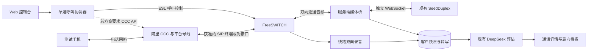

# 阿里云号码 + FreeSWITCH + SeedDuplex：首通真实外呼规划

日期：2026-11-02。本文为开发与准备方案；尚未采购资源、部署 ECS、申请号码或发起真实电话。

## 目标和范围

使用阿里云平台申请的可外呼号码，向本人或已同意测试、录音的人员手机发起一通电话。客户听到现有 SeedDuplex 销售智能体；系统保留客户变量、完整首句锁、后续打断、AsrText/ChatText、双向原录音以及现有 DeepSeek 评估。

首期交付单路、手动发起、手动结束及异常自动释放；沿用现有 JSON 客户导入。通过后再开发批量任务、CRM 抽取、线路容量控制和 FreeSWITCH 集群。

用户已明确：本轮不使用企业自有号码。阿里平台号码可能由其运营商或合作伙伴提供，号码资源、用途、价格和使用权限均以实际获批方案为准。[号码申请说明](https://help.aliyun.com/zh/ccs/cccai/getting-started/apply-for-a-thrid-party-communication-line)

## 第一项前置确认：号码和媒体接入是两个条件

用户提供的两篇文档属于企业自有线路接入云联络中心，不能直接证明阿里会提供可供自建 FreeSWITCH 使用的通用外呼中继。本轮采用阿里平台号码，应优先确认 CCC 的 SIP 坐席/办公电话方案，或阿里明确提供的外部 SIP 接口。[SIP 协议接入说明](https://help.aliyun.com/zh/ccs/cccai/product-overview/sip-protocol-access-description)

CCC 2.0 已有 SIP 终端及话机外呼能力，但官方软电话文档只以 Linphone 为保证范围，其他终端需验证。因此，FreeSWITCH 作为无人值守 AI SIP 终端、具体外呼方式及授权，需要阿里售后明确确认；不能只因 FreeSWITCH 支持 SIP 就视为兼容。[SIP 终端接入](https://help.aliyun.com/zh/ccs/cccai/use-cases/connect-an-sip-softphone)、[办公电话模式](https://help.aliyun.com/zh/ccs/cccai/user-guide/sip-device-and-work-mode)

可以直接向阿里售后提交：

> 我们希望使用阿里平台申请的外呼号码，不接企业自有线路。自建系统部署在阿里 ECS，使用 FreeSWITCH 和火山引擎 SeedDuplex，需将电话双向实时音频交给自建语音 AI，不使用平台 ASR/TTS 代替它。初期仅 1 路，拨打已同意测试和录音的自有手机。请确认：
>
> 1. 哪种 CCC 实例、号码和授权支持此场景？测试号线是否可以开放外部 SIP 终端？
> 2. 是否支持 FreeSWITCH 注册为专用 SIP 话机/办公电话终端？如果不支持，是否提供获准的外部 SIP 机器人接入方式？
> 3. 呼叫由 FreeSWITCH 的 SIP INVITE 发起，还是必须调用 CCC MakeCall？如由平台桥接两条呼叫腿，如何获知客户这一腿真实接通、挂机和失败原因？
> 4. 请提供对应实例的 SIP 地址、端口、传输和鉴权方式、媒体地址、RTP/SRTP、编解码、AVPF、号码格式及公网白名单要求。
> 5. 我们的业务是泓动引擎 GEO 企业销售、筛选意向并请求加微信；完整首句及问答可提供审核。此业务能否承接？单路测试的费用、最低消费、呼叫时段、地区和频次限制分别是什么？
> 6. 能否先用官方推荐客户端证明号码可正常呼出，再预约 FreeSWITCH 双向媒体联调？

如果阿里只开放 Web 工作台，且不能将双向媒体接入自建终端，就不能按本文直接完成 SeedDuplex 电话链路；应先取得适用接口方案，再确定媒体开发。MakeCall 只是呼叫控制接口，本身不等于外部 WebSocket 音频接口。[MakeCall](https://help.aliyun.com/zh/ccs/cccai/api-ccc-2020-07-01-makecall)

## 建议架构

以下是待接入模式确认后的工程设计，不表示阿里已承诺支持 FreeSWITCH。

ESL 负责拨号、事件订阅和挂断控制；还需要独立的双向媒体通道，不能把接通 ESL 当作音频桥接已经完成。[FreeSWITCH Event Socket](https://developer.signalwire.com/freeswitch/integration/event-socket/)

## 需要开发的内容

| 工作包 | 具体工作 | 验收结果 |
| --- | --- | --- |
| ECS 部署 | Node.js 24、构建产物、服务守护、配置迁移、数据库及录音目录、日志 | 通过 SSH 隧道能访问原工作台，重启后数据保留 |
| 呼叫控制 | ESL 连接；按阿里最终方案接 SIP 终端或 CCC API；单路并发、测试号码白名单、拨号幂等、结束按钮 | 能拨响测试手机，能真正挂断，重复点击不重复呼叫 |
| 媒体桥 | 提取客户方向音频、重采样和帧化、逐通 Seed 会话、模型音频回送、有限播放队列 | 两边能持续对话；AI 下行不会混入客户上行 |
| 首句和打断 | 固定开场、媒体端播放进度确认、首句后清空双方待播放队列 | 首句完整；之后插话能停止旧回复且无尾音残留 |
| 状态与数据 | 系统 sessionId、FreeSWITCH UUID、CCC 呼叫 ID 映射；真实接通及挂机原因；录音完成后归档 | 未接通不被当成接通；双方记录和评估属于同一通电话 |
| 记录复用 | 服务端 WAV 原录音支持、现有详情播放、ASR/Chat 和 A–G 评估 | 无浏览器参与也能回看和分析整通电话 |

### 当前代码必须适配的边界

- `server/index.ts` 仅监听 `127.0.0.1`，`server/app.ts` 只接受本机 Host/Origin。首测建议维持这个边界，通过 SSH 隧道访问；公网管理台需另做 HTTPS、登录、访问控制和 Origin 配置。
- `SessionManager` 当前以浏览器 WebSocket 为音频消费者，首句完成确认来自浏览器。需抽出通用媒体端口，增加 FreeSWITCH 适配器，复用 `SeedPeer`，不让电话依赖浏览器页面保持打开。
- `session.created` 当前只代表 SeedDuplex 初始化成功。真实电话的 answeredAt 必须来自客户电话腿的接通事件；振铃、183 早期媒体、SIP 终端注册成功和模型初始化均不算客户接通。若走 CCC 双腿呼叫，不能拿坐席腿接通替代客户腿接通。
- 现有录音来自浏览器，服务端只接收 WebM/MP4/Ogg。电话应由 FreeSWITCH 记录真实双向媒体，增加可信录音路径、WAV 元数据及播放支持。
- 用户忙导致未接通的 SIP 结果属于呼叫状态；不能直接当作 LLM 的 D 级“客户接听后表示在忙”。
- 客户挂机、页面结束、线路失败、模型失败和超时需要幂等收束，停止媒体、关闭模型连接及录音；网络故障不自动重新拨打。

### 音频实现建议

当前模型接口使用上行 PCM16 单声道 16 kHz、20 ms/640 字节，下行 PCM16 24 kHz。电话编码以实际协商为准；若为常见 G.711 8 kHz，应解码并有状态重采样，不能只修改采样率字段。电话本身窄带造成的音质损失不会因上采样恢复。

媒体模块需要同时具备：双向流式传输、可清空的回放队列、进度/排空事件、逐通隔离和可用的线路录音。候选是 `mod_audio_stream` 的双向商业版/获准测试版；其公共源码版与商业双向版能力不同，不能仅安装社区模块就视为已满足要求。版本、FreeSWITCH ABI、操作系统包和许可应先锁定并做本地回放样机。[模块作者发布说明](https://github.com/amigniter/mod_audio_stream/releases/tag/v1.1.0)、[公共版说明](https://github.com/amigniter/mod_audio_stream/blob/main/README.md)

首句解锁条件是“模型输出结束 + FreeSWITCH 对应首句最后音频已消费且队列排空”。之后客户开始说话时，需要同时清理 Node 尚未下发音频与 FreeSWITCH 待播放队列。队列应有界并按音频时钟消耗，避免因为快速灌入音频导致越来越长的回复延迟。

## 你需要准备的信息

| 类别 | 非密钥信息 | 由谁准备 |
| --- | --- | --- |
| 阿里账号和服务 | UID、准确产品名称/版本、地域、CCC 实例 ID、测试/正式实例情况 | 你与阿里售后 |
| 平台号码 | 已批准可外呼主叫、号码来源、固定/随机外显、是否回拨、测试手机地区是否可达、1 路配额、余额及限制 | 阿里/号线合作伙伴 |
| SIP 终端 | 专用坐席 UserId、SIP 分机、注册域名、端口、传输、鉴权及证书要求 | 阿里售后 |
| 媒体 | RTP/SRTP、AVPF、编码和采样率、ptime、DTMF、媒体 IP 网段、是否双腿及客户腿状态接口 | 阿里售后 |
| ECS | 是否已有实例；CPU 架构、OS/版本、地域、配置、固定 EIP、SSH 用户/端口、可用安全组权限 | 你 |
| 模型 | SeedDuplex 已开通与额度、可用音色、自定义热词等现有设置；DeepSeek 配额 | 你 |
| 测试材料 | 一个已同意测试和录音的手机、一条相应客户 JSON、要验证的对话场景 | 你 |
| 数据迁移 | 是否迁移当前客户、限制词和历史录音；备份与保留范围 | 你 |

SIP 密码、SSH 私钥和 API Key 不发到聊天或 GitHub，部署时在服务器的受限配置中填写。如果最终只需 SIP 终端直拨，未必需要阿里 API AccessKey；只有确定需要 MakeCall 等接口时，才增加最小权限 RAM 身份及服务器角色/临时凭据方案。

## 你需要完成的操作

1. 先将上文确认文字交给阿里售后，确认“阿里平台号码 + 外部 FreeSWITCH AI 终端”的可用方式、计费和业务准入。
2. 询问是否有支持这种对接的测试号线/体验实例。普通网页体验号不等于具备 SIP 接入权限；确认后再创建，避免在受限体验资源上绕路。
3. 如使用正式实例，通过 CCC 控制台申请合作伙伴号线，提交企业认证、用途、完整话术和对接需求；选支持本次外呼的号码类型，确认最低消费和覆盖地区后开通。
4. 按最终方案创建专用坐席、配置号码的呼出权限及坐席/技能组归属，初始化 SIP 话机。先用阿里推荐的标准客户端验证号码能够拨通测试手机。[号码管理](https://help.aliyun.com/zh/ccs/cccai/user-guide/phone-number-management)
5. 提供 ECS 配置信息；新购前确认 OS 与 FreeSWITCH/媒体模块兼容。配置固定公网地址和受限 SSH 访问，按阿里提供的实际地址/端口设置网络规则。
6. 准备服务器上的模型环境变量及一条测试客户资料，再进入部署和媒体联调。

GEO 销售、现有首句、加微信邀请均应如实交给号线方确认用途。首次使用已同意参与并允许录音的手机；平台对业务用途、商业联系和录音有使用要求，具体按所选服务及线路执行。[阿里使用限制](https://help.aliyun.com/zh/ccs/restrictions-on-use)

## ECS 与网络建议

工程估算建议单台 x86_64、4 vCPU/8 GiB 内存、50 GiB 以上磁盘、固定公网 EIP 和约 5 Mbps 带宽用于首通开发调试。这是单路候选规格，不是并发容量承诺或云产品报价；无需 GPU，本地不运行语音模型权重。若已有服务器，先核查而不直接重装。

操作系统待媒体模块兼容性验证后确定。开发前从 ECS 测试到 SeedDuplex WebSocket、DeepSeek HTTPS 的连通性，并检查到阿里媒体端的延迟、抖动和丢包；不要只用地域名字推断语音体验。

| 服务 | 首测网络安排 |
| --- | --- |
| SSH | 只向维护者来源 IP 开放 |
| Web/API | 保持本机监听，经 SSH 隧道访问 |
| FreeSWITCH ESL 8021 | 仅本机访问、强鉴权、禁止公网暴露 |
| 媒体桥 WebSocket | 仅本机或受控内网访问 |
| SIP 信令 | 按所选模式、真实实例地址和端口配置；不要混用自有中继与坐席注册参数 |
| RTP/SRTP | 放行双方确认的媒体 IP 和本机实际配置端口范围，正确设置 SDP 公网地址 |

阿里自有线路对接文档里的 UDP 8000/媒体端口范围描述的是该模式下阿里侧服务。SIP 软电话文档另有 TLS 方案，不能直接照搬为 ECS 必须开放的端口列表。[SIP 对接指引](https://help.aliyun.com/zh/ccs/cccai/product-overview/sip-connection-guide)、[SIP 终端配置](https://help.aliyun.com/zh/ccs/cccai/use-cases/connect-an-sip-softphone)

当前数据如需迁移，应对 SQLite 做一致性备份并同时保留录音；不要只复制正在写入的数据库主文件而遗漏 WAL 中的数据。

## 实施顺序与验收

1. **确认接入资格和链路**：拿到阿里对 FreeSWITCH/外部 AI 的支持答复、所选模式和端点资料。
2. **纯电话验证**：标准客户端或 FreeSWITCH 使用平台号码拨通测试手机，确认外显、接听、双向声音和挂断；先排除号码、SIP 和 RTP 问题。
3. **双向媒体样机**：在不连接真实客户的条件下，验证逐通 PCM、模型回送、回放排空和清空队列；确认模块版本、录音和挂断生命周期。
4. **云端工作台与控制接入**：迁移项目、配置服务守护，增加单通外呼/结束按钮、号码白名单和幂等约束。
5. **首通 AI 电话**：先做约 1–3 分钟测试，检查开场、不需要分支、FAQ、微信同号/异号复核、插话和被叫挂机。
6. **数据闭环**：检查手机听到的声音与 FreeSWITCH 录音一致、转写没有重复/串话，结束后自动生成既有 A–G 评估。
7. **异常复核**：未接、占线、拒接、早期媒体、模型断开、媒体中断、页面结束、重复拨号请求均能正确记录和释放资源。线路稳定性联调按阿里约定单独进行。

本轮完成标志：从网页手动发起一通真实呼出，手机与现有 SeedDuplex 持续双向对话；首句锁和后续打断有效；真实接通状态、双向原录音、最终转写和意向评估可回看。批量任务和集群开发以此为后续基础。

## 费用与时间前置条件

需分别确认 ECS、公网与存储、CCC 实例/坐席、号线月租或最低消费/预存、通话费、SeedDuplex、DeepSeek，以及所选媒体模块许可。使用阿里号码不等于只支付 ECS 费用，也不自动意味着取得通用 SIP 中继账号。

开发排期以阿里接入方式和媒体模块兼容性验证为前置条件。号码审核、资源供应和售后联调由阿里及合作伙伴安排；在这些条件确定前，不给出保证拨通日期。
