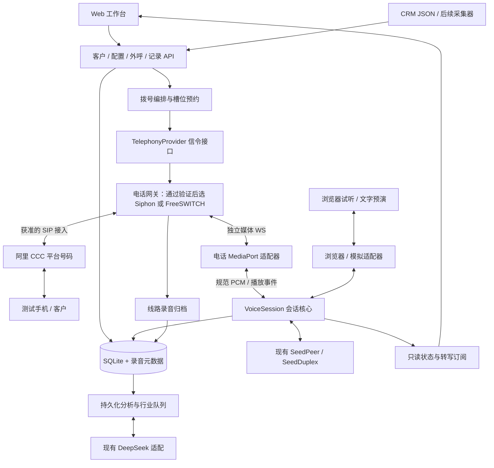

# 架构适配评估与重构规划

评估日期：2026-11-03（北京时间）。本轮重构起点：`e3a31c9`。评估对象：[new_construstion.md](new_construstion.md)。本文件描述目标架构；实际交付状态见[三次重构任务与验收](refactor-tasks.md)。所列新电话接口、目录和状态不表示均已实现，更不表示已完成真实电话验收。

按本次用户要求，整个重构严格拆成三次：**第一次公共语音核心与媒体边界；第二次电话信令、双向媒体和单通验证；第三次控制平面（调度、业务编排、自动工具执行、合规准入）**。第一次已完成；第二次软件实现与本地验证已完成，云端实机待验；第三次待开始。控制平面的槽位预约、任务队列、时段/频次/停止名单校验不提前到前两次实施。第二次只以人工启动、固定并发 1 的工程测试验证电话链路，不作为批量运营入口。具体命令和外部待办见[电话联调说明](telephone-pilot.md)。

## 1. 结论与采用范围

**建议采用“业务调度、电话信令、媒体适配、语音会话、通话后分析”分层，但不建议按原文立即用 Siphon 全面替换原 FreeSWITCH 方案。** 第二、第三板块具有较高复用价值；本次重构的重点是拆开浏览器与语音会话的耦合，再给第一板块接入独立电话通道。

Siphon 是可验证的候选网关，双向 WebSocket 桥接并非虚构。不过当前结论是**有条件适配**，存在三个前置门槛：

1. **阿里平台号码接入方式待确认。** 用户选择的是阿里提供的号码，而原文假设已有可直接对接的 SIP 中继。两者不等价；必须确认所选 CCC 实例允许的外部 SIP 终端、自动外呼和 AI 媒体接入方式。
2. **首句播放完成确认存在能力缺口。** 本项目要求 AI 主动说固定首句，首句不能被打断。核查版本的 Siphon WS bridge 没有可以直接依赖的逐段播放排空回执，不能只凭模型 `audio.done` 解锁。
3. **媒体引擎仍明确标注实验性。** `siphon-rtp` 上游说明不能把功能实现、CI 或版本号当成生产稳定性证明。选择它意味着需要承担版本锁定、必要补丁和真实媒体测试的维护工作。[S1][S2]

因此推荐路线是：**第一次先做不依赖具体网关的会话解耦；第二次验证 Siphon 单路能力，通过后才将其选为首个正式电话适配器；第三次才建设业务控制平面。** Siphon 未通过时继续 FreeSWITCH 路线，复用同一套业务与模型接口。生产通道选一个，不把 FreeSWITCH 和 Siphon 串成两层媒体网关，也不先实现两套完整拨号系统。

当前仓库只有 FreeSWITCH 的预留契约和规划，**没有需要拆掉的 FreeSWITCH 集群、ESL 拨号器或 RTP 桥接实现**。重构不等于推倒第二、第三板块，也不需要先换 React、Express、TypeScript 或 SQLite。

## 2. 原方案的逐项评估

| 原方案内容 | 评估 | 本项目的处理 |
| --- | --- | --- |
| 控制平面与媒体分离 | 契合 | Node 负责客户、任务、资源预约、CDR 和结果；网关负责 SIP/RTP；语音核心负责 SeedDuplex |
| 一通电话一模型会话、上下文独立 | 契合，当前已有基础 | 保留客户、配置、提示词及哈希快照，不跨客户复用 Seed 会话 |
| 可用槽位池 | 契合，但定义不完整 | 同时考虑线路并发/CPS、模型额度、媒体与应用容量；外呼时段是准入条件，不是容量 |
| 按接通率倒数超额拨号，起步 3:1，再上 PID | 不适合当前阶段 | 首通和初期批量使用 1:1 预约式拨号；不允许已接通客户排队等待 AI |
| 已有境内 SIP 中继，Siphon 直接 INVITE | 与当前号码条件不一致 | 以阿里平台号的实际终端/API 接入方式重做线路方案，不能套用自有中继示例 |
| Siphon 同时处理信令与双向媒体 | 能力方向成立 | 实际是 `siphon-sip` 加 `siphon-rtp`；WS bridge 要求后者，不能换成普通 rtpengine 后端仍假定可用 |
| 用 Voice AI 入呼示例直接实现外呼 | 不足 | Siphon 有 originate，但自动锚定媒体的路径默认是无 SDP 的 INVITE；CCC 是否接受 late offer、需要 early offer 时如何提供合法 SDP，必须验证 |
| Siphon 接通后连接 Node 的 WS 服务端 | 成立 | 电话媒体入口独立；Node 的模型侧则是连接火山的 WS 客户端 |
| 上行 16 kHz / 下行 24→16 kHz | 适合一个明确配置的方案 | 必须读取实际 `start.data.media`；校验单声道、16 bit、小端序、采样率和 ptime，再帧化和封装 |
| 上行音频“原样送入模型” | 表述不准确 | Siphon 是二进制 PCM，SeedDuplex 是 JSON 内嵌 Base64；Node 负责协议转换和实时节拍 |
| `clear` 后收到 `cleared` | 请求和回执均需更正 | clear 必须携带实际 `data.streamId`；回执为 `type=mark`、`data.name=cleared`。它表示清空，不表示自然播放完毕，也不承诺一个 ptime 的端到端延迟 |
| Siphon 默认本地 VAD 自动打断 | 与首句锁有冲突 | 自定义 profile 关闭 `ws_barge_in`；首句后由会话核心根据 Seed 事件执行清队列，避免两个独立打断决策互相干扰 |
| `ws_tee` 旁路保存通话录音 | 在目标 Takeover 形态不可直接使用 | 该版 engine 拒绝给没有 relay 路径的 takeover 加 tee；改验证原生 `record_start` 双向录音 |
| 工具调用通过 `session.update` 回传 | 协议不准确 | 工具结果使用 `conversation.item.create`、`role=tool`、同一工具 `call_id`；前两次保留已有人工协议，第三次才做自动工具执行 |
| 每 10 秒静音包、90 秒释放 | 没有找到当前协议依据 | 使用官方实时音频与 mute/unmute 约定；模型静音、WS 心跳和 SIP/RTP 保活分别处理 |
| 等模型关闭后，WS `stop` 就释放电话 | 不成立 | 电话挂断必须走信令控制；`stop` 只结束 bridge。客户挂断时立即停止媒体，模型确认独立有界等待 |

Siphon bridge、录音与控制的依据见 [S3]—[S10]；SeedDuplex 的依据见 [V1][V2]。原文涉及许可资质的概括不作为已核实结论；本项目以所选阿里服务的业务准入、号线合同和对接要求为实际前提。

### 为什么先不用预测式超额拨号

接通率是概率，不能作为已接通通话的容量保证。假设只有一个可用 AI 槽位，同时拨三通且各自接通概率为 30%，在独立假设下，同批至少两通接通的概率为 `3×0.3²×0.7 + 0.3³ = 21.6%`，存在接通时间重叠的风险。这不是实际呼损率预测；实际呼叫未必独立，更不能据此保证不会超载。

本项目没有真人坐席兜底，也不需要通过延长通话挤出资源。默认约束应是：

```text
本轮允许新增拨号数 <= 可用且已预约的 AI 槽位数
资源容量上限 = min(线路允许并发, Seed 允许并发, 媒体实测容量, 应用实测容量)
可用数 = 资源容量上限 - 已预约拨号 - 已接通占用
```

上述是**第三次控制平面**的目标约束：拨号中也占预约，忙线、未接、失败后释放；“尚未创建计费模型连接”和“没有预留模型容量”是两件事。呼出 CPS、同号频次、允许时段也在第三次做准入检查。第二次的单路测试仅用固定并发 1 的互斥限制，不能将其称为槽位池或预约调度。先提高号码质量和并发容量，后续确有需求再单独评估预测策略，不把 85%–90% 利用率设为当前目标。

## 3. 建议的目标架构

初期保持单仓库、单台 ECS 和一个 Node 业务进程。逻辑边界先明确，运行进程只在确有隔离或容量需求时拆分。



图中的阿里连接是**待验证的接入路径**，不是已经拿到的通用 trunk。若阿里要求用 MakeCall 发起、让 SIP 终端接听坐席腿，`TelephonyProvider` 应封装该流程，而不是坚持让 Siphon 直接向客户号码发 INVITE。[A1]—[A5]

媒体桥继续经过现有 Node 语音核心，不改成网关直接调用模型。这能保留完整模型参数、提示词快照、FAQ 快回复、文本归并、人工干预与意向分析，不需要重新实现第二板块。

### 模块边界与实施归属

| 边界 | 负责 | 实施归属 |
| --- | --- | --- |
| 控制平面 | 选择客户、准入、拨号幂等、预约、释放、任务恢复、自动工具执行 | 第三次；业务外呼和批次入口在此建设 |
| `TelephonyProvider` | 注册/线路状态、发起/取消/挂断、真实客户腿状态、结束原因 | 第二次；先由人工测试驱动，不带自动任务调度 |
| `MediaPort` | 音频格式、输入/输出、清空、排空、媒体断线 | 第一次契约和浏览器实现；第二次电话实现 |
| `VoiceSession` | Seed 生命周期、首句门控、ASR/ChatText、快速回复、现有人工配置干预 | 第一次；不依赖浏览器 WebSocket，自动业务编排留第三次 |
| 记录与分析 | 转写、来源与模型时间、播放事实、录音、结束后分析 | 第一次保证旧功能兼容；第二次补真实 CDR 和线路录音；第三次关联任务 |

`MediaPort` 的“排空”是本项目要求适配器满足的能力，**并非声称 Siphon 当前已有同名 API**。应区分 `canClearPlayback` 与 `canConfirmDrain`；不满足后者的通道不能启用严格首句模式进入真实电话验收。

### 目标接口及所属任务

| 本项目接口 | 约定与实施归属 |
| --- | --- |
| `POST /api/call-attempts` | 第三次业务 API。提交 `customerId`、已配置的 `routeId` 和幂等键；返回 `callAttemptId/sessionId/status`。请求被接收不等于已拨出或接通 |
| `POST /api/call-attempts/:id/end` | 第三次业务 API。未接通时取消，已接通时挂断；重复请求返回同一终结过程，不再拨号 |
| `GET /api/call-attempts/:id` | 第三次业务 API。查询真实线路、模型、媒体与录音状态；关联既有会话详情 |
| 独立观察订阅 | 第一次。仅推送状态/转写，不携带音频消费责任；订阅断开不结束媒体会话 |
| 独立服务间 `/media/siphon/...` | 第二次。仅接受预先创建、校验关联的测试会话及短期凭据，校验 start/二进制帧；不混入旧 `/ws/sessions/:id` 的浏览器 JSON 协议 |

这些名称是规划中的项目 API，不是阿里或 Siphon 原生端点。第二次可用受限的命令行或测试驱动调用信令适配器；不提前创建业务外呼 API、任务队列、重拨策略或准入引擎。原有 `POST /api/sessions`、配置、客户和记录 API 继续用于试听与历史兼容。上游 originate 超时导致结果未知时停止测试并核对活动呼叫，禁止直接重试发第二通；第三次再将其纳入持久化幂等与恢复编排。

## 4. 哪些拆掉、哪些修改、哪些复用

### 4.1 拆除或替换的耦合

| 当前位置 | 拆除内容 | 去向 / 处理时机 |
| --- | --- | --- |
| `server/sessions.ts` 的 `attach()`、`LiveCall.client`、`send()` | 浏览器 WS 同时充当媒体端、事件订阅者和会话所有者 | 拆成浏览器媒体适配器、会话核心和只读观察者；浏览器试听仍可保留断线即结束的策略 |
| `providerEvent(session.created)` | 模型初始化成功等同客户接听，并立即开场 | 模型只记 ready；电话真实 answered、模型 ready、媒体 ready 三者齐备后才开始首句 |
| `store.ts` 启动回填 SQL | 对全部 `mode=seed` 按 `session.created` 回填 `answered_at` | 改为带版本的一次性历史迁移，仅适用旧试听记录；电话记录绝不回填假接通 |
| `web/src/App.tsx` 离开页面的 finish | 操作页面离开等同真实电话挂机 | 电话观察页退出只取消订阅；明确“结束通话”才发挂断指令 |
| `server/contracts.ts`、`docs/plan.md` 的固定 FreeSWITCH 占位说明 | 将某个尚未实现的网关写死为唯一方向 | 改成已验证能力和实际选择的网关，保留接口版本和历史说明 |
| 旧软电话虚拟声卡路径 | 依赖 Linphone 人工拨号、浏览器路由和双重结束 | 当前基线已删除演示入口及相关组件；本次不恢复，旧记录兼容保留 |

不删除旧通话、提示词快照、客户资料、音色设置或历史评估。当前基线已删除 `SoftphoneBridge.tsx` 与 `audio-routing.ts`；后续通过独立电话媒体端口接入，不重建软电话页面或虚拟声卡方案。

### 4.2 需要修改的现有模块

本表是最终改动范围，不能视为第一次的交付清单。第一次只处理核心/媒体抽象、共享类型、只读观察与历史迁移护栏；电话状态和录音在第二次加入；外呼 API、任务调度、业务编排及自动工具在第三次加入。具体归属见[三次任务表](refactor-tasks.md)。

| 文件 | 修改规划 |
| --- | --- |
| `server/sessions.ts` | 提取 `VoiceSession`；播放锁、转写归并、快回复和控制逻辑保留；`finish/fail/cleanup` 改幂等异步收尾 |
| `server/types.ts`、`web/src/types.ts`、`shared/dashboard.ts` | 共享领域类型；分离电话状态、模型状态、播放状态和媒体来源，兼容旧客户端 |
| `server/seed.ts` | 保留云端协议；补充可等待关闭、可观察发送失败/背压和 ready 状态，避免上层把丢帧误认为发送成功 |
| `server/store.ts` | 增加呼叫尝试、来源、号码/线路、时间、网关 ID 与播放事实；版本化迁移；调整分析触发和重启恢复 |
| `server/app.ts`、`server/index.ts` | 增加单通外呼 API、观察订阅和独立服务间媒体入口；浏览器旧接口保持兼容 |
| `server/recordings.ts` | 支持受信网关产出的 WAV、流式/文件归档、录音完成事件、来源与完整性；保留旧浏览器上传和回放 |
| `server/analysis.ts` | 保留 A–G 与微信证据校验；用真实挂断原因和实际播放事实区分早挂、忙线、媒体故障 |
| `server/jobs.ts` | 复用持久化任务和有界重试；电话结束与最终转写收束后幂等入队，不让录音失败阻塞文本分析 |
| `server/dashboard.ts`、`Store.listSessions()` | 真实电话、浏览器试听、软电话演示分开统计/筛选；接通率不再混入模型 ready |
| `web/src/App.tsx`、`CallRecords.tsx`、`Dashboard.tsx`、`api.ts` | 新增真实外呼入口与状态；列表保留现有列和分页，补来源、线路结果及录音状态；观察页面关闭不挂机 |
| `.env.example` 与文档 | 新增网关和服务间鉴权的占位配置；发布时固定二进制/SDK 版本及镜像摘要，不把密钥放进前端 |

### 4.3 直接复用的资产

| 资产 | 保留价值 |
| --- | --- |
| `server/prompt.ts`、`prompts/sales-agent.md` | 泓动引擎角色、变量注入、每通完整提示词与配置快照 |
| `server/sales-script.ts`、`quick-reply.ts` | 行业/地区自然表达、FAQ、首轮拒绝一次性快路径及状态保护 |
| `shared/model-config.ts`、`validation.ts` | 现有可控参数与干预事件校验，不另做一套不完整配置 |
| `web/src/PromptControl.tsx`、`ModelSettings.tsx`、`LiveControls.tsx` | 已有配置与实时控制页面，连接新的核心控制服务即可 |
| `server/deepseek.ts`、`shared/analysis.ts`、行业补全流程 | 行业新增 `industry`、A–G、微信事实、结构校验和证据引用 |
| SQLite 的客户、设置、转写、事件与分析任务 | 先做增量迁移；无需为了单路试电话立即换数据库 |
| 浏览器 `audio.ts`、`capture-worklet.js`、文字 `Simulation` | 保留用户要求的模拟电话、浏览器试听；不让调试功能依赖 SIP 资源 |
| 记录页分页、日期筛选、等级颜色、详情和音频播放器 | 扩充元数据即可，不重新设计第三板块 |
| 现有协议、提示词、分析、录音、队列与 UI 相关测试 | 作为重构前后的业务回归基线 |

### 4.4 新增目录建议

以下为职责建议，实施时可按改动规模合并文件；不要求一次建立所有空目录。

```text
shared/
  call.ts                       # 领域状态、来源、网关事件、播放与录音事实
server/
  voice/session.ts              # 第一次：从 SessionManager 提取的语音核心
  voice/events.ts               # 第一次：Seed 转写/播放关联与核心事件
  media/port.ts                 # 第一次：通用媒体契约与能力声明
  media/browser.ts              # 第一次：现有 /ws/sessions/:id 协议适配
  media/siphon.ts               # 第二次：PoC 通过后实现的 Siphon PCM/控制适配
  media/resampler.ts            # 第二次：有状态重采样
  media/framer.ts               # 第二次：帧化、时钟、有界队列
  telephony/provider.ts         # 第二次：网关无关的信令接口
  telephony/siphon.ts           # 第二次：按阿里确认方式封装信令，不预设 trunk
  dialer/service.ts             # 第三次：外呼业务编排、幂等和准入
  dialer/slots.ts               # 第三次：初期单进程原子预约
  tools/                        # 第三次：会话内自动工具执行与结果回传
  recordings/gateway.ts         # 第二次：可信线路录音归档
  migrations/                   # 第一次起：可重复安全执行的版本化增量迁移
deploy/                         # 通过验证后增加版本锁定、服务守护和配置样例
```

如果采用 FreeSWITCH，只替换 `telephony/siphon.ts`、`media/siphon.ts` 对应的实现，不改动提示词、分析和 UI 契约。

## 5. 电话生命周期与关键工程约束

### 5.1 一通真实外呼（第三次完成后的目标流程）

以下完整流程含控制平面，不在第一次或第二次提前实现。第二次只用人工测试驱动验证第 3—9 步的信令、媒体、状态、收尾与录音；资源限制为固定并发 1，不包含第 1—2 步的自动准入与预约。用于既有浏览器试听的模型初始化、首句门控和幂等收尾属于第一次核心职责。

1. 操作者选择客户，提交带幂等键的单通外呼请求。按允许时段、测试白名单、线路状态和资源容量检查，创建一次 `callAttemptId`，冻结客户、配置和提示词快照。
2. 原子预约一路线路/媒体/模型容量。初期建议在发出真实呼叫前先使 Seed 会话 ready 并保持输入静音，以减少客户接听后的等待；模型初始化失败则不拨出。此时仍不记客户接通，也不播放开场。
3. 通过 `TelephonyProvider` 发起呼叫。振铃和 183 早期媒体只记线路状态，不将回铃音送入模型，不开始销售对话。
4. 收到**真实客户腿**接通事件，保存网关时间和本地接收时间；建立/确认媒体格式。CCC 双腿场景必须区分坐席腿与客户腿，不能只拿终端 SIP 200 就认定手机已接通。
5. 客户接通、模型 ready、媒体 ready 均满足后，进入首句锁并发送现有固定打招呼文本。锁期间不上传客户音频，忽略模型/媒体的插话取消，不清空开场；客户挂机、人工结束和故障收尾始终有效。线路录音仍应保留双方真实声音。
6. 开场生成完成且该响应的最后音频已在网关媒体队列消费后，才解除锁并恢复模型输入。播放完成确认属于网关边界，不能保证远端手机音量、扬声器和用户确实听见。
7. 后续 Seed ASR started / response canceled 按现有策略触发受保护的清队列：同时清 Node 未下发帧和网关旧响应帧。首轮拒绝快速回复继续使用现有官方 replacement 控制，不额外调用 DeepSeek。
8. 被叫挂机、操作员结束、线路失败或模型/媒体不可恢复故障，统一进入幂等收尾；停止新输入输出、取消/挂断电话、关闭模型、结束录音并终结记录。按来源保存结束原因，确认电话资源释放后只释放一次预约；挂断结果未知时隔离相应容量并核对，不能继续将该槽位用于新拨号。
9. 最终转写在有界收束窗口内归并后，已真实接通的通话写入现有分析队列；录音可独立从 finishing 变 ready/failed。迟到转写若改变已分析输入，按版本标记结果过期并安排幂等重评。

“模型表达告别”暂不等于电话已挂机。首版保留显式结束和有界最长通话时限；需要自动结束时，再明确受控的结束信号、最后一句排空和信令挂断流程，不能用关键词猜测直接挂机。

### 5.2 首句锁是 Siphon 验证的硬门槛

现有浏览器实现的双条件要保留：`模型该响应 audio.done` **且** `媒体该响应 drain`。Siphon 的默认 `voice_ai` profile 有本地自动 barge-in，必须显式关闭；只静音模型不足以保护网关已经排队的首句音频。

本次核查版本的 WS schema 虽然出现 `mark`、播放分段相关类型，但 bridge 控制实现没有可直接使用的通用播放排空确认。[S5] 因此选择 Siphon 有两条可验证路线：

- 在锁定的媒体引擎版本补齐“响应边界/样本序号 → 对应最后帧实际消费后回执”，并处理 `clear`、结束、断线和旧回执，交给上游或维护最小补丁。
- 单独验证固定首句走引擎原生文件播放及播放完成事件的方案；需证明当前 Takeover/外呼路径确实支持、音色与文本一致、生成等待可接受。它是候选替代方案，本次没有验证通过。

两条都不成立，就不让 Siphon 承担正式通道。不能把 `mark=cleared`、WS 发送完成、Node `bufferedAmount=0`、估算音频时长或固定睡眠当成已满足 drain。原生 `play` 的完成事件即使存在，也不能自动证明 WS 流式音频具有同等能力。

播放边界应携带 `responseId` 与代次/序号；清空会取消旧响应，不得把旧回执用于解锁新一轮。网关清空到 `cleared` 的耗时应实测，不能在方案中写死“一个 tick”。

### 5.3 音频处理

优先验证 Siphon WS 使用 16 kHz、单声道、PCM16 小端序。每通独立保存转换器、帧缓存和时钟状态，不跨通话共享。

```text
客户 RTP → 网关解码/重采样 → 二进制 PCM 16k
  → 校验 start.data.media / 重组 20ms 640B / 按实时时钟发送
  → Base64 + input_audio_buffer.append → SeedDuplex

SeedDuplex response.output_audio.delta → Base64 解码 → PCM16LE 24k
  → 有状态低通重采样 24k→16k → 有界播放队列 → 二进制 WS
  → 网关按媒体时钟编码并发送客户 RTP
```

模型音频 chunk 不保证恰好一帧；重采样必须跨包保留相位和滤波状态，不以丢弃每三个样本中的一个代替正确下采样。不要重复添加两套彼此漂移的节拍；使用单一单调时钟和队列水位协调。音频队列以毫秒/样本数度量，超限明确失败并收尾，不积压整段过期语音。

若协商不是目标格式，应显式转换或拒绝该次媒体连接，不能只改采样率标签。电话窄带上采样不恢复已丢失的声音细节。噪声抑制/回声消除按实测启用，避免未经验证的双重处理损伤音质。

### 5.4 录音

本项目已经要求详情播放原录音，因此线路录音是交付项，不是可省略的远期功能。

Siphon Takeover 下不采用 `ws_tee` 假设。核查版本有原生双向录音路径，可验证 `record_start` 的 `direction=both`、`channels=stereo` 和 WAV 输出；收到 `RecordingFinished` 后才归档可播放文件。[S6][S7] 此能力适用于引擎原生锚定的 WS 通话；将已有两方 relay 动态接管的路径另有限制，不能一概视作支持录音。

必须实测录音包括客户输入和**网关的 AI 播放渲染轨**，首句锁时客户声音仍保留，被清掉的未播放帧不混进 AI 声道；不能把模型完整生成音频或模型输入副本称作线路原录音。该版录音 tap 位于下行编码/发送之前，不能单靠文件证明 RTP 发送成功或远端实听；发送失败需标记 incomplete 并结合线路状态复核。[S11] 保存录音来源、格式、声道、采样率、字节数、时长、完整性、开始/完成时间和失败原因。

网关返回的文件路径只在受控录音目录解析，不能提供任意文件读取接口。录音转换/归档离开实时媒体路径；网页播放接口继续支持范围读取。旧 WebM/Ogg/MP4 不转写、不替换，继续回放。

### 5.5 模型控制与工具

继续由 `server/seed.ts` 组装 `session` 和同级 `extension`，保留全部已支持参数。`session.update` 仍用于模型配置更新，不作为工具结果回传。

**自动工具执行全部属于第三次控制平面。** 届时按一次 `response.function_call_arguments.done.items[]` 建批次，执行受允许的工具、限定超时并按 `call_id` 去重；该批结果汇聚后使用官方 tool item 格式回传。不能把会话工具排进通话结束后的 DeepSeek 分析队列。前两次仅保留已实现的人工控制和工具协议透传/记录，不自动执行 CRM 写回、转人工或订单操作。既有通话后 DeepSeek 分析队列继续复用，它不是新增的外呼调度队列。

不硬编码原文的“10 秒/90 秒”保活数值。按官方实时音频、mute/unmute 和当前协议超时说明实现，另行管理 WS ping 与 SIP 会话刷新；它们相互不能替代。[V1][V2]

## 6. 数据与兼容迁移

### 6.1 标识与状态

保留 `sessionId` 作为网页详情和历史记录主键。单通试点可采用一次外呼尝试对应一个会话；重拨产生新的尝试和会话，不覆盖旧 CDR。

| 新增/明确的字段 | 作用 |
| --- | --- |
| `callAttemptId`、`campaignId?` | 一次拨号尝试及后续批次归属 |
| `transport/source` | browser / softphone_bridge / 真实电话；真实电话再保存 gateway 类型 |
| `gatewayChannelId`、`gatewayCallId`、`sipCallId`、`seedSessionId` | 分开关联供应商标识；工具 `call_id` 属于另一命名空间 |
| `callStatus` | queued、reserved、dialing、ringing、answered、busy、no_answer、rejected、ended、failed、cancelled 等电话状态 |
| `modelStatus`、`mediaStatus`、`playbackStatus` | 模型连接、媒体可用与 opening/active 等对话播放状态，独立于电话接通 |
| `dialedAt`、`modelReadyAt`、`mediaReadyAt`、`answeredAt`、`endedAt` | 分离电话、模型、媒体时间；保留来源和本地接收时间 |
| `answerSource` | 历史模型初始化、人工演示确认、真实客户腿事件；来源不混用 |
| `hangupInitiator`、`hangupCause`、`sipStatus` | 区分客户早挂、忙线、未接、操作员结束、模型失败和媒体失败 |
| `recordingStatus`、`transcriptRevision`、`analysisInputRevision` | 录音独立完成、分析输入可追踪 |
| 播放事实 | 按响应保存 started/completed/interrupted 及可验证的已消费进度；不是逐帧写 SQLite |

这些状态是本项目领域设计，由适配器映射供应商事件；不要把它们当成 Siphon 或阿里原始事件名。

### 6.2 迁移顺序

第一次落实版本化护栏、来源/模型时间及历史兼容，避免未来电话被自动回填成接通；第二次才增量增加真实线路、客户腿与录音字段；第三次才增加拨号任务、准入、预约和工具执行状态。迁移结构不应提前创建未实现的业务能力。

1. 对当前 SQLite 做一致性备份，同时保留录音；不直接复制写入中的主文件而遗漏 WAL。
2. 新增有版本的迁移表，先修复 `store.ts` 无范围回填，再加入电话表/字段与索引。保留旧接口的默认 browser 行为。
3. 历史 `answeredAt` 保留原值并标记 legacy 来源，补充可推断的模型 ready 信息，不伪造运营商接通时间；历史提示词、配置和评估原样保留。
4. 新电话的 `answeredAt` 只接受经适配器核验的客户腿事件。重复、乱序和终态后的迟到事件不让状态倒退。
5. 当前“重启就把所有 active 标失败”的逻辑区分来源：旧试听可继续结束；电话进入恢复核对，查询网关和线路实际状态。无法可靠接管时终止孤儿电话，不恢复录音重播、不自动重拨。
6. 新查询增加 source/transport 筛选，真实电话指标默认只统计真实来源；历史试听仍可查询。分析触发条件按来源明确，不改变旧历史结果。

### 6.3 保留第三板块的业务口径

A–G 规则、颜色、微信同号/异号展示、客户原话证据和至少两轮有效回应的 B 级规则保持。SIP 忙线是未接通结果，不能记成 D 级“客户接听后说在忙”。未接通电话有 CDR，但不送意向分析。

当前 C 级判断使用最终 `ChatText` 轮数；电话中“生成第二句”不等于“第二句已经开始播放”。需给分析补入播放事实和真实挂断原因，避免排队却未播出的第二句影响早挂判断；客户许可和微信号码仍必须来自客户证据，不能由播放元数据推测。

## 7. 阿里平台号码与部署前置验证

用户提供的两篇 SIP 文档讲企业自有号码接入 CCC，不是把阿里平台号码交给任意网关使用的证明。SIP 软电话官方示例是注册终端路径；MakeCall 是控制 API，不是返回音频的 WebSocket。[A1]—[A5]

| 需要确认/实测 | 必须得到的结果 |
| --- | --- |
| 产品、地域、号码、专用坐席及业务准入 | 平台号码允许本项目 GEO AI 单通测试，并允许选定外部 SIP 终端方式 |
| 呼出控制 | 终端直接拨号，或 CCC API/回呼坐席腿；主叫由服务分配，不能任意填写外显 |
| SIP 兼容 | REGISTER、鉴权、TLS/证书、代理、Contact/NAT、会话刷新、SDP/AVPF 与实际媒体要求；确认平台是否接受 offerless INVITE，early offer 路径如何生成 SDP。Siphon 支持通用 SIP 不等于已经兼容 CCC |
| 媒体 | 双向 RTP/SRTP、编码、ptime、IP/端口和公网 SDP 正确；客户能听见，而非只证明注册成功 |
| 状态 | 可获得客户腿真实接通、挂断和未接原因，双腿事件能准确关联 |
| 官方基线 | 先用阿里推荐客户端与同一号码、同一测试手机验证，便于把号线问题和网关问题分开 |

需要准备的信息沿用 [阿里 SIP 首通规划](aliyun-sip-pilot-plan.md)：实例/坐席和地域、平台号权限、SIP 端点/凭据、ECS 与固定公网地址、Seed/DeepSeek 配额、测试手机与客户样例。密钥和 SIP 密码在服务器配置，不写入文档或 GitHub。

ECS 与号码实测归第二次，先按单路部署，沿用此前 4 vCPU / 8 GiB 等建议作为工程估算，最终看所选二进制、OS 和测试结果；它不是并发承诺。采用 Siphon 时锁定 SIP、RTP、协议库和控制 SDK 的兼容组合；初期验证普通 UDP 媒体后端即可，不把 eBPF/XDP 部署列为首通前提。

Web/API 暂保留本机监听与 SSH 隧道。第二次的独立媒体入口只向本机/私网开放，使用逐通短期凭据并校验其与测试会话的绑定；凭据若放 URL 必须从访问日志脱敏。Siphon 控制通道单独鉴权。这些是技术接入边界，不是第三次的业务准入引擎。不能为方便接入删除 `localRequest()` 或将现有无登录工作台直接暴露公网。容器部署须明确私有网络地址与来源，不能把容器的 localhost 当宿主机。

## 8. 三次实施任务、交付与停止条件

细分工作包、验收和实际结果集中维护在[三次重构任务与验收](refactor-tasks.md)。本次只启动第一次，不自动推进第二、三次。

| 次数 | 状态 | 交付 | 验收 / 停止条件 |
| --- | --- | --- | --- |
| 第一次：公共语音核心与媒体边界 | 已完成本地实现与回归 | 网关无关会话核心、MediaPort 与浏览器适配、独立只读观察、共享来源/状态类型、版本化历史迁移护栏 | 本地自动回归、类型检查与构建通过；云端音频和真实电话仍待后续验收，详见实际交付记录 |
| 第二次：电话信令与双向媒体 | 待开始 | 阿里平台号接入确认；Siphon 门槛验证和首个电话适配器；人工单通发起/取消/挂断；真实客户腿状态、音频转换、鉴权、线路原录音与真实首通 | 以固定并发 1 的人工测试验证；不做槽位调度、外呼任务、重拨或准入引擎。无法满足阿里接入、严格首句 drain 或双向录音时停止该网关路线，评估 FreeSWITCH 替代 |
| 第三次：控制平面 | 待开始 | 调度与槽位池、持久化外呼队列、业务编排、幂等/重试/重启核对、自动工具执行、时段/频控/停止名单准入、暂停/恢复和批次 UI | 小规模获准测试无重复外呼、无超额接通、无跨客户串音；拒绝准入不发出呼叫；工具去重、有界超时并正确回传；故障后资源可核对释放 |

原阶段映射：原 R1 → 第一次；原 G0/G1、R2 中信令/媒体/录音部分、原 R3 → 第二次；原 R2 的 1:1 预约、原 R4 以及按瓶颈扩展容量 → 第三次。原文的预测式超额拨号和 PID 仍不纳入这三次的默认实现；第三次先按真实可用容量做 1:1 预约，不把未经测试的容量扩展当成验收结果。

第二次以号码/线路和网关能力门槛通过为前提，所需外部资料可提前准备，但不因准备资料扩张第一次范围。号码审批、上游能力补齐和真人试听时间独立于代码开发，不在未验证时承诺上线日期。

## 9. 验证清单与回退

### 软件回归

- 保留现有提示词变量、配置快照、FAQ/快回复、Seed JSON、增量转写去重、工具控制与两通隔离测试。
- 浏览器试听仍按真实播放排空解锁；旧软电话入口不恢复，相关历史记录可查看；只读观察断开不影响媒体，浏览器媒体自身断开仍可按试听策略收尾。
- 电话状态重复/乱序、183、坐席腿先接通、客户早挂、忙线、未接、取消拨号均不污染接通时间和意向等级。
- 首句模型 done 但媒体未 drain 时仍锁住；首句忽略 clear；后续同时清 Node/网关旧队列，旧回执不影响新响应。
- 音频连续包重采样、跨包余数、格式不符、时钟漂移、积压上限、断线均有可观察结果。
- 新库/旧库迁移、重启不回填假接通、孤儿呼叫收束、重复结束仅入队一次、迟到转写版本一致。
- 录音文件完成后再发布，WAV/旧格式回放、部分失败、路径限制及原音频完整性有验证。
- 通话记录、日期/状态/等级排序、分页、微信同号/异号、来源筛选与看板统计回归通过。

每次任务运行 `npm run typecheck`、相关 `npm test` 和 `npm run build`，只声明本次已实现范围通过。自动协议测试不能替代阿里线路、Seed 真实音频与原录音验收；第一次不要求也不声称电话链路验证通过。

### 现场验收与监控

用获准测试手机逐项验证首句、首轮拒绝、任意阶段 FAQ、微信许可/号码、后续插话、挂机、模型断开、媒体断开和操作页关闭。容量阶段再做多路测试，不从批量客户外呼开始压测。

指标至少包括：预约/振铃/接通数、模型建连错误与 429、真实接通至开场首帧、客户判停至首个回送音频、播放队列毫秒数、清空回执耗时、录音完成率、分析积压和孤儿资源数。先实测 P50/P95/P99，再订阈值；上游 `siphon_b2bua_max_concurrent_calls` 是特定入呼限制配置，0 还可代表不限，不能直接用于外呼槽位的除法或容量判断。[S10]

### 回退原则

以配置选择新尝试使用的电话 provider；活动通话不热切换媒体网关。关闭新外呼后等待或有序结束现有通话，再切回已验收路径；浏览器试听持续可用。

数据库采用增量兼容迁移，但**不能拿仍含“所有 Seed 会话回填 answered_at”逻辑的旧程序直接启动升级后的数据库**。回退程序也必须保留迁移护栏和来源语义；如需完整恢复快照，应同时核对新增通话与录音，不能静默丢失升级后数据。

## 10. 调研依据与证据边界

本次阅读的是当前源码，不以 `new_construstion.md` 内“在采纳 Siphon 之后”的措辞视为用户已经决定替换网关。上游文档会变化；部署需再次锁版本并实测。

Siphon 核查快照：`siphon-sip v1.15.11`（`f1924f396e367196c782e954c7ad9d42234765b9`），配套协议依赖 `siphon-rtp-proto 0.19.0`；媒体引擎 `v0.19.0`（`4aaaa4b51f4f2d024b0e5224560fc7053157dd79`）；TypeScript 控制 SDK `@siphon-project/control 0.12.0`。[版本依赖](https://github.com/siphon-project/siphon-sip/blob/f1924f396e367196c782e954c7ad9d42234765b9/Cargo.toml#L88)、[SDK 清单](https://github.com/siphon-project/siphon-sip/blob/f1924f396e367196c782e954c7ad9d42234765b9/siphon-control-sdk/typescript/package.json)。这组快照用于解释本次结论，不表示已在本项目安装或通过兼容验收。

- [S1：SIPhon 官方仓库与 MIT 许可](https://github.com/siphon-project/siphon-sip/blob/f1924f396e367196c782e954c7ad9d42234765b9/LICENSE)
- [S2：siphon-rtp 官方仓库的实验状态](https://github.com/siphon-project/siphon-rtp/blob/4aaaa4b51f4f2d024b0e5224560fc7053157dd79/README.md)
- [S3：官方 Voice AI cookbook](https://siphon-sip.org/cookbook/voice-ai/)：WS 客户端方向、bridge/tee 区别与 profile 行为。
- [S4：媒体 API 与 attach/tee 能力](https://siphon-sip.org/reference/media/)
- [S5：clear/stop/mark 实际处理](https://github.com/siphon-project/siphon-rtp/blob/4aaaa4b51f4f2d024b0e5224560fc7053157dd79/crates/siphon-rtp-media/src/bridge/audio.rs#L515-L547)：其余消息未形成可用的逐段排空确认。
- [S6：Takeover 拒绝 tee](https://github.com/siphon-project/siphon-rtp/blob/4aaaa4b51f4f2d024b0e5224560fc7053157dd79/crates/siphon-rtp-engine/src/engine/tee.rs#L103-L116)；[原生 Ws 录音分支及限制](https://github.com/siphon-project/siphon-rtp/blob/4aaaa4b51f4f2d024b0e5224560fc7053157dd79/crates/siphon-rtp-engine/src/engine/record.rs#L554-L582)；[双方声道选源](https://github.com/siphon-project/siphon-rtp/blob/4aaaa4b51f4f2d024b0e5224560fc7053157dd79/crates/siphon-rtp-engine/src/engine/record.rs#L620-L690)。
- [S7：控制平面官方说明](https://github.com/siphon-project/siphon-sip/blob/f1924f396e367196c782e954c7ad9d42234765b9/docs/reference/control-plane.md)：originate、控制连接、挂断、record_start 和录音完成。
- [S8：核查版本 WS 格式、clear 所需字段与采样率](https://github.com/siphon-project/siphon-rtp/blob/4aaaa4b51f4f2d024b0e5224560fc7053157dd79/docs/cookbook/voice-ai.md#the-websocket-wire)
- [S9：网关关联注册凭据](https://github.com/siphon-project/siphon-sip/blob/f1924f396e367196c782e954c7ad9d42234765b9/docs/reference/gateway-api.md#linking-a-destination-to-its-registration)；[不同 Takeover 路径的安全媒体限制](https://github.com/siphon-project/siphon-rtp/blob/4aaaa4b51f4f2d024b0e5224560fc7053157dd79/docs/cookbook/voice-ai.md#which-callers-a-takeover-supports)。
- [S10：容量指标定义](https://github.com/siphon-project/siphon-sip/blob/f1924f396e367196c782e954c7ad9d42234765b9/src/metrics/admission.rs#L1-L42)
- [S11：录音 tap 与下行编码/发送的先后顺序](https://github.com/siphon-project/siphon-rtp/blob/4aaaa4b51f4f2d024b0e5224560fc7053157dd79/crates/siphon-rtp-media/src/bridge/session.rs#L400-L425)
- [V1：SeedDuplex 官方接口](https://docs.volcengine.com/docs/doubao-voice/end-to-end-real-time-voice-full-duplex-version?lang=zh)
- [V2：SeedDuplex 接入必读](https://docs.volcengine.com/docs/doubao-voice/access-must-read?lang=zh)
- [A1：阿里 SIP 协议接入说明](https://help.aliyun.com/zh/ccs/cccai/product-overview/sip-protocol-access-description)
- [A2：阿里 SIP 对接指引](https://help.aliyun.com/zh/ccs/cccai/product-overview/sip-connection-guide)
- [A3：阿里 SIP 软电话](https://help.aliyun.com/zh/ccs/cccai/use-cases/connect-an-sip-softphone)
- [A4：阿里 SIP 设备与办公模式](https://help.aliyun.com/zh/ccs/cccai/user-guide/sip-device-and-work-mode)
- [A5：阿里 MakeCall API](https://help.aliyun.com/zh/ccs/cccai/api-ccc-2020-07-01-makecall)

本次完成源码与官方资料调研，没有进行 Siphon 安装、阿里注册、真实拨号、Seed 云端音频或并发压测。计划中的前置门槛因此保持待验证状态。
