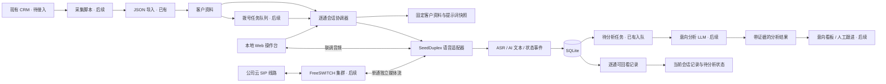
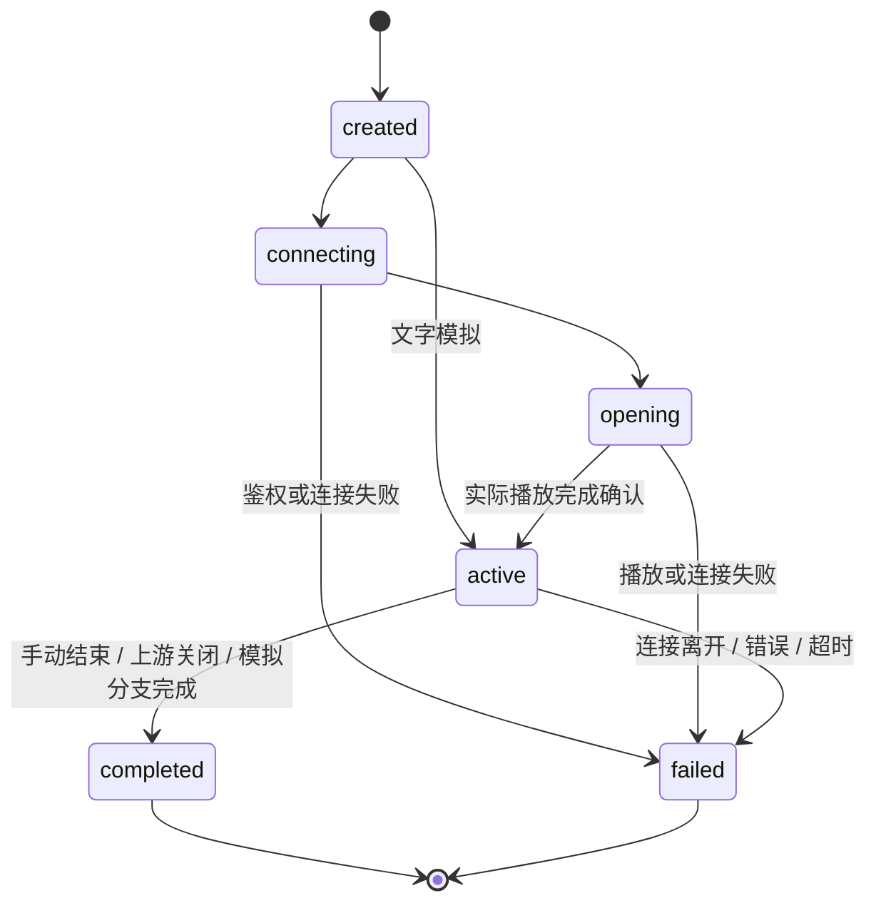
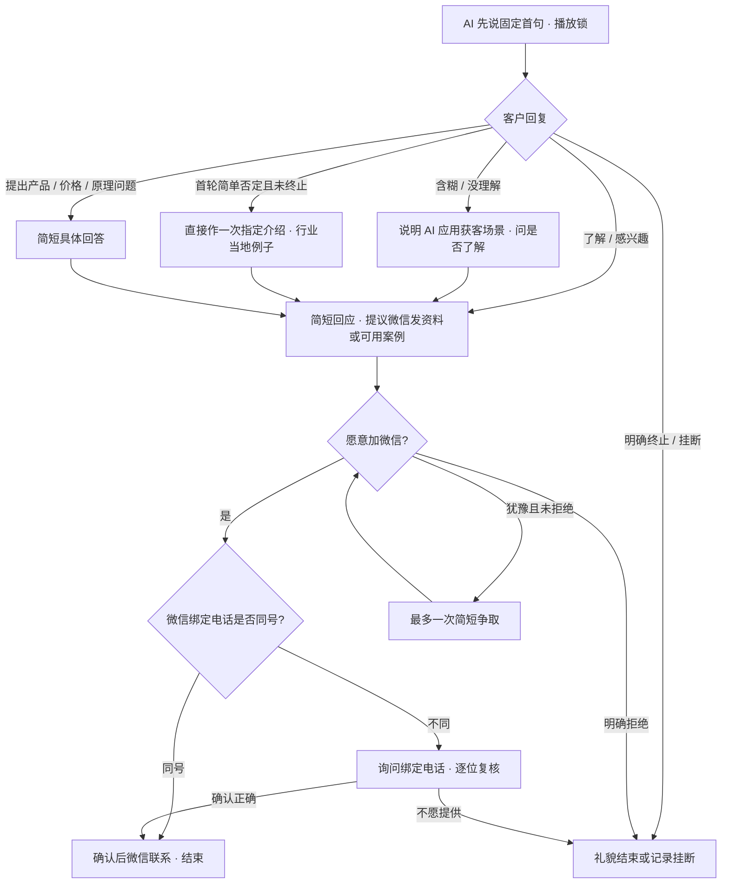

# 泓动引擎 AI 电话销售系统：总体方案与交付路线

> 实施状态更新：第二板块和第三板块现已落地，包含 DeepSeek 行业补全、持久化评估队列、A–G 结果、分页记录与浏览器原录音。第三板块的当前接口、等级和边界以 [分析模块说明](analysis.md)、`shared/analysis.ts` 与 `server/contracts.ts` 为准。下文保留最初分期设计；其中“分析后续/未实现/不持久化录音”等表述属于当时规划，已由本次实现替代。真实 SIP 外呼仍待接入。

## 目标与当前交付范围

系统面向本地部署的 Web 操作台，按“客户接入与拨号 → 独立语音会话 → 记录与意向分析”组织。当前首先打通第二板块：每通电话独立注入客户资料的 SeedDuplex 语音智能体、真实语音联调、完整文本记录与可回看会话。第一板块的 CRM 批量采集、云 SIP、FreeSWITCH 集群拨号，以及第三板块的外部大模型分析，先保留明确接口和数据边界。

业务的成功标准是筛选出愿意进一步了解、允许人工微信联系的客户，并准确确认联系方式。不要把延长通话、提高模型输出字数或强行成交设为目标。用户提供的接通后分布“30% 首句挂断、60% 明确拒绝并挂断、7% 否定后等待、3% 感兴趣”是尚未验证的业务假设，应在积累真实记录后重新统计，不能作为已测得指标。

本地 MVP 的文字模拟只按规则生成对话回复，用于快速验证分支和资料注入，不产生意向标签或评分，也不代表 SeedDuplex 已产生该文本。真实语音使用火山引擎 SeedDuplex 3.0 JSON WebSocket 接口；API 参数、事件及鉴权以[用户指定的官方文档](https://docs.volcengine.com/docs/doubao-voice/end-to-end-real-time-voice-full-duplex-version?lang=zh)及本项目语音适配实现为准，不混用旧版二进制事件协议。

## 三个板块的结构



| 模块 | 当前 MVP | 后续接入 |
| --- | --- | --- |
| 本地 Web | 客户与单通会话、配置、文字模拟、语音联调、逐通文本及状态查看 | 批次任务、线路与并发管理、人工跟进队列 |
| 客户资料 | JSON 导入与字段校验，按规范化电话去重更新，按记录选择客户 | 只读 CRM 导出适配器、增量同步、外部客户 ID 映射与任务筛选 |
| 提示词 | 固定模板、客户变量注入、每通快照、首句常量 | 版本对照、经审核的行业案例库 |
| 语音会话 | 每通独立 SeedDuplex WebSocket、音频上/下行、首句播放锁、事件记录 | FreeSWITCH 媒体适配器、集群调度及线路容量控制 |
| 结果 | 原始文本、会话状态；完成后写入待分析任务，不产生意向标签或评分 | 外部 LLM 结构化分析、带证据的意向标签、人工复核 |
| 存储 | 本地 SQLite 逐通持久化 | 负载需要时迁移数据库；接口保持不变 |

## 一通电话的生命周期

1. 当前由操作台选择一条客户记录创建独立 sessionId，不经过自动拨号队列。固定客户资料、配置和完整提示词，并为提示词计算内容哈希。活跃会话不会因为客户列表或配置被编辑而改变资料。未来电话网关的 callId 与 sessionId 需明确关联。
2. 建立此通电话专属 SeedDuplex 上游会话。供应商密钥仅在服务端使用，浏览器只连接本地服务，不获取密钥。
3. 建立音频输出消费者后，由 AI 主动说固定开场。第一句音频播放完成前，阻止客户音频进入模型，并禁止中断或清空首句音频队列。当前通过 opening/active 会话状态及供应商事件追踪这一过程，不持久化逐帧播放进度或每个播放确认事件。
4. 只有实际播放端确认“首句最后一帧播放结束”，才解除首句锁并进入正常全双工对话。模型生成结束、WebSocket 已收到完整音频、服务端把数据写入缓冲区都不等于客户已听完。当前播放异常或超时标为失败并结束，需要新建测试，不会无条件解锁假装开场成功。
5. 保存供应商非音频事件、客户 ASR 文本、AI 文本和最终/中间态。适配层将文本映射为 AsrText 与 ChatText，保留事件 ID 等关联信息；不持久化音频帧，也不把模拟文本当成真实上游事件。
6. 当前真实语音测试中，模型可以按提示词告别，但尚未接入自动挂断工具。操作员点击“结束”才正常完成并释放连接；客户端离开/断开、错误或超时也会清理资源，并按实际原因结束状态。供应商主动关闭会话时正常完成。文字模拟可在规则分支结束时直接完成。未来 FreeSWITCH 接入后，才由电话网关的 hangup 操作完成真正电话挂断。重复结束请求不重复清理。
7. 已完成会话写入 pending 分析任务，当前没有分析 worker 消费任务，也没有规则意向分析或外部 LLM 结果。未请求分析与待分析状态分别保留，人工仍可查看原始对话；不自动生成微信同意、号码确认或意向结论。



## 提示词与对话设计

模板位于 `prompts/sales-agent.md`，由 `server/prompt.ts` 的 `buildPrompt(customer, config)` 构建完整提示词。构建无时间、随机值或跨通可变状态，保存返回字符串即可得到可重放、可哈希的完整快照。客户资料使用一次 JSON 序列化的专用数据块，包含 `&camp`、`&name`、`&phone`、`&address`；不采用全局字符串替换，避免名字或公司名中的模板符号被二次展开。数据里的“忽略指令”等文本不应变成系统规则。

默认首句如下，可在限制词控制页的模型参数中修改；每通仍独立固定开场及播放锁：

> 歪～，哎您好，我们这边儿是豆包的服务商，主要是帮咱们公司做豆包上的推广和精准获客，那这方面您有了解过吗？

“豆包的服务商”按用户提供的流程图保留；上线外呼前应由业务负责人核实这一身份表达对应的实际资质与授权。没有案例库时，不得直接宣称“已做过很多咱们行业的案例”，模板保留该节点的意图，改用实际可提供的资料。客户问题的分支、语气词、河北口语、年费 12800 元、季度 3800 元、简明 GEO 实现解释、同号/异号确认均已纳入模板。生成引擎的提及与推荐不由服务商控制，因此不得把示例场景表述成付费即保证曝光。



流程图是对话意图，不是强制每步走一遍，其中“结束”表示对话收束意图；真实语音 MVP 的连接仍需按上文方式结束。是否同意微信、是否同号、异号是否复核未来应作为独立事实提取，当前只保留原始对话，不生成这些结构化结论。客户说“不需要但先听听”与“别再打了”必须区分；明确结束后不能重新回到邀请节点。文字模拟限制一次争取，避免反复循环。

## 客户 JSON 与 CRM 接入边界

当前 `POST /api/customers/import` 接口输入为 `{ "customers": [...] }` 包装对象，数组元素字段约定如下。仓库的 `examples/customers.json` 是供操作台读取的数组文件，操作台导入时包装为该 API 请求；其中仅包含虚构演示资料，不可当作实际拨号名单。

| 规范化字段 | 提示词字段 | 约定 |
| --- | --- | --- |
| id | id | 内部记录由服务器生成的唯一标识；导入不接受 CRM id 作为内部标识，输入额外 id 会被忽略；未来可另增 externalId 映射 |
| camp | &camp | 客户公司名称，保留原文 |
| name | &name | 客户姓名/称呼，保留原文 |
| phone | &phone | 电话必须为字符串；当前导入移除空格、括号和连字符，保留前导零与 `+`；按该规范化电话去重并更新既有客户；未来拨号前再按线路规则处理 |
| address | &address | 客户地址；模型只使用明确的地区，不补造 |
| industry | industry | 可选行业；优先于从公司名称推断 |

未来 CRM 适配器只负责获取、分页、字段映射和增量游标，不在采集脚本里直接拨号。具体页面/API/鉴权尚未提供，当前未实现该公司的 CRM 抓取。接入时优先使用已有的只读导出/API；若必须脚本操作页面，另行处理页面变化和登录态。当前客户导入按规范化电话识别既有记录，重复导入更新资料并保留服务器内部 id；未来的拨号任务仍需单独实现批次级幂等，不能将客户去重等同于拨号任务去重。

建议预留接口：

```ts
interface CustomerSource {
  pull(cursor?: string): Promise<{ customers: Customer[]; nextCursor?: string }>;
}
interface DialTask {
  taskId: string;
  customerId: string;
  batchId: string;
  status: 'queued' | 'leased' | 'dialing' | 'completed' | 'failed' | 'cancelled';
  attempt: number;
  idempotencyKey: string;
}
interface TelephonyAdapter {
  dial(task: DialTask): Promise<{ callId: string; providerCallId: string }>;
  hangup(callId: string, reason: string): Promise<void>;
}
```

这些是架构契约示意，不代表当前已有 CRM 或 SIP 实现。任务队列需要原子领取、租约续期、有限重试与线路容量限制，避免多个 worker 抢到同一客户后重复拨打。

## FreeSWITCH 与通话隔离的后续实现

每通电话分配独立 callId、上游 WebSocket、提示词快照、音频缓冲、首句锁、事件序号与清理句柄。不能让多个客户共用一个 SeedDuplex 会话；不能用全局“当前客户”“当前音频队列”等可变变量。后台自动外呼只连接 FreeSWITCH 的逐通媒体流，不走浏览器扬声器，无须旁听或实时人工审核。

后续由公司云 SIP 配合 FreeSWITCH 完成呼叫建立和挂断；当前尚无 SIP 拨号端点或挂断工具。计划中的媒体适配器将线路协商得到的电话音频解码、重采样为模型要求的单声道 PCM；目标上行为 16 kHz PCM、下行为 24 kHz PCM，再按 SIP 实际协商的 8 kHz 电话编解码转回线路。8 kHz 是常见电话线路目标，并非所有 SIP 都必须如此；实际采样率、字节序、帧长、编解码和事件以官方会话配置与协商结果为准。重采样必须有状态地跨帧处理，不能只改音频头的数字。

首句播放锁应在 FreeSWITCH 媒体端确认最后一帧实际输出后解除；浏览器联调时则由 Web Audio 播放队列排空确认。首句锁期间客户音频不能进入模型，锁结束后再按全双工逻辑处理打断。需用合成双通音频验证客户 A 的任何音频/文本/变量都不会进入客户 B 的会话，并验证挂断后不继续发送音频。

集群调度时同时考虑 SIP 并发配额、SeedDuplex 并发配额、FreeSWITCH worker 容量和 CPU 重采样开销。先做两路隔离与稳定结束，再逐步压测并发；未经压测不承诺批量吞吐量。

## 记录、数据结构与第三板块接口

当前 SQLite 保留会话、客户与配置快照、非音频供应商事件、角色文本和待分析任务的关联，内部通过 sessionId 关联，供应商会话 ID 仅作为外部信息。文本有角色、时间戳、供应商关联 ID 与最终态；同一条转写的中间态更新为最终态，不重复拼成多句。当前没有持久化音频、逐帧播放进度、结构化微信确认或意向结果。

当前已完成会话只创建一条 pending 任务，任务无结果且尚无消费 worker。未来分析器消费已结束会话的固定文本快照，并返回结构化结果；版本与输入哈希、幂等重跑、分析失败状态等需在接入阶段补齐，不影响已完成通话的可回看记录。

第三板块的预留输入、结果字段统一以 `server/contracts.ts` 中 `INTEGRATION_CONTRACTS.analysis` 为契约示意，本文不另维护一套 schema。其 plannedResult 使用 `intent: unknown | rejected | curious | interested`、`wechatConsent`、`sameAsDialed`、`wechatPhone`、`summary`、定位原始转写的 `evidence` 和 `needsHumanReview`。这些是未来结果字段，不代表当前已生成相应值；若要支持客户只提供微信号、独立的号码复核事实及模型版本等，需要先扩展该统一契约再实现。

中文看板标签分别为“未知、拒绝、待了解、感兴趣”。未知表示缺少判断依据，不能默认为拒绝；愿意听介绍不自动等于愿意加微信；同意加微信不自动等于号码已确认。所有结论应附能定位原始文本的证据，不能仅凭通话时长、关键词出现或模型自信程度判断。

当前规则只用于文字模拟回复，没有规则意向标签、规则评分或 LLM 分析。新建会话的 analysisStatus 为 not_requested，完成后为 pending，导出结果为 null。页面不声称已完成意向分析、真人复核、已成功加微信或已发资料。

## 里程碑与验收

| 阶段 | 交付 | 退出条件 |
| --- | --- | --- |
| M0：结构与本地模拟 | 项目启动、客户 JSON、提示词快照、模拟对话、记录回看 | 无供应商密钥也能验证完整数据流，模拟来源清晰 |
| M1：SeedDuplex 真实联调 | 官方接口鉴权、逐通连接、浏览器音频、首句播放锁、ASR/AI 记录 | 配置有效凭据后，真实完成一通可回看对话；错误与断线可解释 |
| M2：话术与自然度调优 | 音色/语速与提示词参数、分支样本、号码复核 | 人工试听并对照场景通过；不只检验文字模拟 |
| M3：拨号闭环 | CRM 适配、FreeSWITCH 单通媒体、SIP、任务队列 | 两路独立会话隔离通过，再逐级验证并发和失败恢复 |
| M4：意向分析与人工交接 | 外部 LLM、带证据的意向看板、人工跟进状态 | 标注样本对照评估，分析来源与确认事实清楚可追溯 |

当前代码框架聚焦 M0–M1，M1 是否真实通过取决于火山引擎账号权限、有效凭据、音色授权及实际试听，不应因本地构建/自动化测试通过而宣称模型已联通。

应覆盖以下验收场景：

1. 按本通配置的首句逐字一致、AI 先说；客户在首句中讲话时，首句继续完整播放，输入不会触发模型打断；只在真实播放完成后解锁。
2. 客户肯定了解、模糊回答、否定后等待、明确终止、随时插问价格/原理，均能进入对应分支且不机械重复。
3. 同意微信且同号；同意但异号；异号听错后更正；只给微信号；愿意了解但不愿加微信；静音与告别。当前通过原始转写核对，结束语音测试需点击结束；未来的结构化分析不得把未确认号码标为已确认。
4. 明确行业与地址正确带入；行业含混不硬猜；客户资料包含换行、引号、`&name` 或“忽略规则”时不会二次替换或成为控制指令。
5. 两通同时运行时提示词、音频、转写、结束状态完全隔离；手动结束、断线或供应商关闭后及时释放本通连接和缓冲。真正 SIP 挂断后的清理留待 FreeSWITCH 接入验证。
6. 供应商鉴权失败、连接超时、音频格式异常、浏览器麦克风不可用都给出可操作状态；不泄露服务端密钥。
7. 重启后记录仍可回看；中间 ASR 与最终文本去重正确；模拟和真实来源清晰；未调用 LLM 时不出现已分析结论。

评估指标优先采用接通后有意愿比例、微信同意比例、联系方式确认准确率、后续重复拒绝或明确终止后的及时结束率、资料与通话隔离正确率，以及人工试听的自然度。首轮简单拒绝按新版脚本直接介绍一次；首句挂断率可用于观察话术，但并不单独说明模型质量；线路接通率属于拨号板块指标。

## 尚需实际接入信息

下一阶段联调需要火山引擎应用权限和服务端环境变量、可用音色、账号并发额度；拨号阶段需要云 SIP 的接入和编解码参数、FreeSWITCH 媒体接入方案、CRM 的实际导出/API 字段；分析阶段需要确定大模型供应商、字段输出约束、业务标注样本和人工跟进流程。在信息未齐前，保留接口、示例数据和明确的未配置状态，不用假凭据或假通话结果填满看板。
