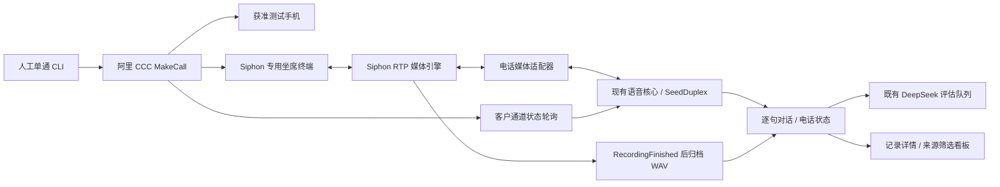

# 第二阶段：人工单通电话联调

**当前路线已在 2026-11-05 经用户确认改为 UDP 8000 网关直连。本文的 CCC 坐席注册/MakeCall 操作属于保留方案，当前实际命令和配置请使用 [ECS UDP 直连操作说明](ecs-ip-only-runbook.md)。**

日期：2026-11-03。当前交付是阿里 CCC 控制、Siphon 电话媒体与现有 SeedDuplex 核心的工程测试链路。软件回归和真实媒体引擎的本地合成回环已有证据，**阿里注册、ECS 部署和手机真实通话尚待现场验收**。本地 UDP / WebSocket 回环不能证明公网音质、SIP / SDP 兼容、电话接通率或云上延迟。

2026-11-05 更新：专用 SSH 已能登录 ECS。最新外接信息、服务器资源、官方坐席端点、CA/证书名称兼容性和准备状态见[真实电话准备检查](real-call-readiness.md)；本文下方保留通用操作步骤，不表示每一项仍未准备。

本阶段固定并发 1、固定获准测试手机、人工命令启动，没有业务拨号 HTTP API。自动选客户、批次、预约、调度、CPS、自动工具执行与合规准入引擎仍放在第三阶段。

## 链路和记录



Siphon 作为 CCC **坐席 SIP 终端**注册，阿里平台号码不被当作可任意拨出的通用 SIP trunk。本次路径不串联 FreeSWITCH。SIP 进线先通过提供商来源网段及专用分机校验，再交给已打开的人工测试窗口；没有该窗口时拒绝进线。

坐席腿接起、媒体就绪和模型初始化均不能代替客户接通。只有轮询取得同一实例、同一 CCC JobId、同一被叫号码且 `UserId` 为空的客户通道 `ANSWERED`，才记录 `answerSource=ccc_customer` 并允许 AI 开场。固定首句仍由 AI 先说，首句门控等待模型生成完成和匹配播放段的媒体发送端排空。

本项目的 `hongdong-playout-v1` 排空补丁验证实际 UDP 发送和最后一帧时长；它不代表远端手机扬声器逐帧确认。应保留补丁、锁定版本及媒体能力声明，不能换成未经修改的引擎后用定时器猜首句播完。详细证据见[网关回环与补丁说明](siphon-poc.md)。

电话会话的 `playbacks` 单独保留网关播放事实：`playbackId` 标识播放段、`responseId` 关联对应模型输出、`opening` 标识首句，`startedAt` / `drainedAt` 分别记录网关真实 RTP 开始发送 / 成功排空回执的接收时间。`scope=gateway_rtp_egress` 限定为网关发送端证据；缺少 `drainedAt` 时不能认定该段完整播放，`ChatText` 或模型完成事件也不能替代。它们均不证明远端手机实际听到了内容；旧浏览器 / 历史记录缺少这些字段时不补造。

客户原话和 AI 原话继续存入当前会话，复用已有提示词快照、FAQ、客户变量、WeChat 结果及 DeepSeek A–G 评估。网关先录制线路双轨 WAV，收到对应 `RecordingFinished` 后才检查普通文件、可信目录、PCM16 结构与大小并原子归档。文件上限 128 MiB；浏览器原有 25 MiB 上传和旧录音仍独立保留。录音失败会显示状态，不阻塞已接通对话的文字分析。

## 尚需准备的信息

| 项目 | 需要的内容和操作 |
| --- | --- |
| ECS 登录 | 在 ECS 控制台给本次部署公钥授权，并确认可登录的 SSH 用户；私钥保留在其所属电脑。服务器 `/root/...` 路径不能直接当本机私钥路径使用 |
| CCC API 鉴权 | 在服务器私有 `.env` 填 RAM AccessKey，或成套临时 AK / Secret / STS token；保证能够操作此实例坐席。SIP 密码不能替代这些凭证 |
| 实例与坐席 | 确认地域、CCC InstanceId、完整 UserId，及该坐席的办公电话模式 / SIP 设备设置。不要把分机号填成 UserId |
| 平台外呼号 | 通过 `ListOutboundNumbersOfUser` 返回的 `Number` 精确核对 `Caller`，不凭长度猜测、截短或转换；`669` 开头可能是官方体验版测试号码 |
| 测试手机 | 固定一个获准号码写入 `PILOT_TEST_PHONE`。体验版限 50 通、创建时的 5 个固定白名单号码，先确认手机已在名单及剩余额度 |
| SIP 端点 | 从当前实例坐席配置或阿里支持确认 SIP domain、注册认证用户名、TLS registrar 域名与端口、来源 CIDR、媒体网段与 SDP / SRTP 要求。未经确认的地址及 BYOC `8000` 说明不能替代坐席注册地址 |
| ECS 网络 | 提供本机内网 IP、EIP / SIP 域名、可校验证书及阿里实际可达的 Contact / RTP 地址；确认该接入场景允许第三方终端 |
| 语音与分析 | `SEED_API_KEY` 必需；`DEEPSEEK_API_KEY` 用于通话后评估。已有产品背景、话术和模型参数由会话快照继续复用 |

阿里 API / 体验号的官方依据与参数说明见[接口核对](aliyun-api-notes.md)。这些资料补齐前，可以运行配置检查和无外呼回环，不应声明已能完成真实手机通话。

## 配置与路径

从仓库根目录开始，使用 Node.js 24+。已有 `.env` 时直接补齐缺项，**不要用示例覆盖现有文件**；首次设置才复制 `.env.example`，权限建议设为 `600`。不要把真实 AK、SIP 密码、测试手机或录音放进 Git。

`.env.example` 已列出标准变量，分为 CCC API、专用 SIP 坐席、Node 媒体 / 控制、ECS 和录音挂载。关键点如下：

- `ALIYUN_CCC_REGION_ID` 和 `ALIYUN_CCC_ENDPOINT` 对应真实实例地域，华东 2 使用 `cn-shanghai`。
- `ALIYUN_SIP_REGISTRAR_URI` 使用裸 `sip:已确认域名:端口` 或 `sips:已确认域名:端口`，不追加 `;transport=tls`；TLS 由 SIP 配置的独立 transport 字段指定。
- `SIPHON_CONTROL_TOKEN`、`SIPHON_RTP_CONTROL_SECRET` 是两个独立随机密钥，均至少 32 字符。引擎 secret 文件内容必须与后者完全一致。
- `PILOT_GATEWAY_RECORDINGS_PATH` 和 Compose 的 `SIPHON_RECORDING_DIR` 是同一个 **ECS 宿主机绝对目录**。Node 的 `SIPHON_RECORDINGS_PATH=/recordings` 则是引擎容器内路径。业务归档目录 `GEO_RECORDINGS_PATH` 与网关原文件目录分别管理。
- Node API、媒体入口、网关控制和管理口默认仅回环监听。API 工作台没有作为公网管理站点开放；使用 SSH 本地转发访问。

SIP / 媒体部署参数存在于进程环境中。Node CLI 会自行读取 `.env`；`start-sip.sh`、Python 预检和 Compose 不会自动把根目录文件里的所有值导入其进程环境，启动前应由私有服务环境注入。若手工使用 `set -a; . ./.env; set +a`，文件须由自己维护且兼容 shell 引号；不要 source 外部提供的不可信配置。

## 部署顺序

1. 通过 ECS 控制台授权公钥，验证 SSH 登录后再传项目和私有配置。安装 Node.js 24、Python 3、Docker / Compose；按锁文件执行 `npm ci`。备份原数据库与配置后再启动新版本，禁止第二个后端同时打开同一数据库。
2. 按[网关说明](siphon-poc.md)安装锁定的 SIP `v1.15.11`。官方二进制的 libc / CPython 要求需与目标系统匹配，不能假定任意 Alibaba Linux 均可直接运行；已核对的官方二进制基线为 glibc ≥ 2.39。没有相应系统时先解决运行环境或源码构建。
3. 复制 `siphon.yaml.example` 到私有配置路径，填服务器证书、域名、接口、注册端点、CIDR 以及路由绝对路径。SIP 信令入口和 RTP `30000–30199/UDP` 仅按阿里提供的对应网段开放，不能给公网开放 `8080`、`8081`、`9092`、`3000`、`3001`。ECS 的 host-network 模板仅针对 Linux。
4. 生成私有引擎 secret 文件和录音目录，并设置 `SIPHON_RTP_CONTROL_SECRET_FILE`、`SIPHON_RECORDING_DIR`、ECS 地址。以下命令构建带补丁的媒体镜像并启动引擎；构建时不要传密钥作为 build args：

   ```sh
   docker compose --env-file .env -f deploy/siphon/compose.ecs.example.yml build media
   docker compose --env-file .env -f deploy/siphon/compose.ecs.example.yml up -d media
   ```

5. 在已导入私有环境的终端或服务中检查并启动 SIP 进程：

   ```sh
   python3 deploy/siphon/preflight.py
   sh deploy/siphon/start-sip.sh
   ```

   `start-sip.sh` 自带相同预检。初始配置默认 SIP 只监听回环；真实入站必须显式配置正确的本机接口、公告域名和受限安全组。确认阿里控制台与网关均显示专用设备注册成功，再进行单通测试。

6. 在 ECS 上执行下面的 doctor 命令，逐项核对 CCC 身份、无活动通话、Caller 权限及网关注册。完整 release 镜像和实际 SIP / TLS 仍需在目标机验证，本地回环已有的编译结果不能替代这一步。

部署模板不会替你申请号码、创建 RAM、开放安全组、签发证书或自动配置阿里坐席。它也不是一键部署整个产品的脚本。

## 人工命令

只检查字段，不注册 SIP、不拨号：

```sh
npm run phone:doctor
```

增加只读在线检查，查询 CCC 坐席 / 外呼号码和 Siphon 注册情况：

```sh
npm run phone:doctor -- --online
```

检查 `missing` / `errors`、`seedKeyConfigured`、`seatIdentityMatches=true`、`seatHasCall=false`、`callerAuthorized=true`、`registered=true`。退出码 `2` 表示字段或语音密钥缺失 / 配置无效，`3` 表示在线预检不通过，执行异常为 `1`；`0` 仅表示本次所选预检项目通过，不能替代手机实听。在线查询失败或缺失字段均不表示可以拨号。该命令不会调用 `MakeCall`。

首次使用固定测试手机的虚构客户资料：

```sh
npm run phone:pilot -- --dial --sample
```

使用已经导入的客户 UUID（将 `CUSTOMER_UUID` 替换为该客户的 UUID）：

```sh
npm run phone:pilot -- --dial --customer CUSTOMER_UUID
```

`--sample` 优先复用数据库中同一个测试手机号的客户；不存在时创建一条联调用虚构公司 / 联系人资料，号码仍取私有 `PILOT_TEST_PHONE`。`--customer` 对应客户的电话也必须与这个固定手机相同，命令不能拨给任意 CRM 客户。`--dial` 是人工显式启用信号；不带该标志拒绝拨号。每次执行只请求一通，不循环、不批量、不自动重拨。

此命令自己启动本地 API 和分析工作台，先停止原有 `npm start` / `dev:server`，避免两个后端同时打开数据库；开发 Vite 前端可单独保留。CLI 输出新建会话 ID，拨号后可以查看通话记录或只读观察；页面断开不结束电话。按 `Ctrl+C` 请求结束本次测试，之后必须检查外部资源释放结果。

Seed / 网关故障、状态无法确认、API 超时、媒体过载会停止本地流程并尝试清理。`unknown` 或 `cleanupStatus=unknown` 表示 CCC / SIP 外部资源尚无法确认已释放；禁止直接再次拨号。先人工核对同一个 CCC JobId 与网关通道，保留诊断记录。当前测试命令没有自动恢复、解除未知记录或重拨入口。

通话结束后 CLI 会唤醒现有持久分析队列；配置了 DeepSeek 时最多额外等待 55 秒，人工退出可结束等待。超时、重试中的任务保留在数据库，不自动发起另一通电话。命令退出后可运行 `npm start` 继续处理队列并刷新工作台；`DEEPSEEK_API_KEY` 缺失时保留等待状态。不要把最后显示 `analysis=pending` 当成已完成评估。

访问 ECS 工作台时使用 SSH 转发的本地地址，例如将本机端口转到 ECS `127.0.0.1:3000`，浏览器通过本机地址进入。`npm run build` 生成前端，API 继续使用本地访问边界；不需要为了测试把管理端和媒体 WebSocket 暴露到公网。

## 验收记录

先完成一次正常手机实听，再覆盖首句中插话、首句后打断、FAQ、请求加微信及同号 / 异号确认、早挂、忙线 / 未接、人工取消、模型 / 网关断线和观察页退出。每项记录本地会话 ID、CCC JobId、真实接通与结束时间、对话文本、线路录音和资源释放结果。

工作台默认保留所有来源统计。选择“真实电话”可单独查看 CCC 客户接通记录；浏览器试听和历史演示保持原有来源口径。电话详情分别展示客户接通时间、模型就绪时间、线路状态、录音归档状态与可播放 WAV。未有客户接通证据的记录不进入客户意向评估。

本地已完成的媒体回环、协议 / 归属校验、首句排空、旧响应、隔离、生命周期、存储 / 迁移、录音和来源统计回归只证明软件边界。当前外部待完成项以[最新准备检查](real-call-readiness.md)为准；其中 SSH 已验通，RAM、正式 SIP/证书兼容性、网段与 ECS 运行环境仍待完成，之后才能记录阿里注册、手机音质 / 延迟和首通结果。第三阶段继续保持未实施。
